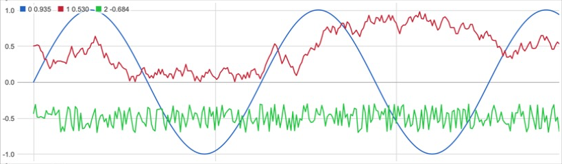
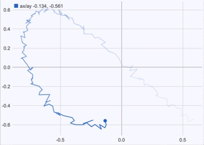

# idoi.sensorkit

Tools for working with sensor data in Max: calibrate it, plot it, record it to
CSV and play the recordings back with their original timing.

```
sensor ─► idoi.calibrate ─► idoi.plotter
                        └─► idoi.datarecorder ─► .csv ─► idoi.dataplayer ─► (your patch)
```

| Object | Create it with | What it does |
| --- | --- | --- |
| idoi.calibrate | `v8 idoi.calibrate.js` | Learn min/max per channel, normalize, clip, invert, smooth, deadband |
| idoi.plotter | `v8ui @filename idoi.plotter.js` | Real-time time series, or x/y trails |
| idoi.datarecorder | `v8ui @filename idoi.datarecorder.js` | Record lists to timestamped CSV files |
| idoi.dataplayer | `v8ui @filename idoi.dataplayer.js` | Play those CSV files back in time |

Requires **Max 9** or later (`v8` / `v8ui`).




## Install

Clone (or download) into your Max packages folder and restart Max:

```bash
git clone https://github.com/idoiidoi/idoi.sensorkit.git ~/Documents/Max\ 9/Packages/idoi.sensorkit
```

Open **Extras > idoi.sensorkit** for an overview patch that chains all four.
Option-click (Alt-click) any of the objects for its help patch.

---

## idoi.calibrate

Send `learn 1`, move the sensors through their whole range, send `learn 0`.
From then on each list is mapped per channel to 0..1 (or `@outrange`). The
learned ranges are saved with the patcher. Channels without a range pass
through unchanged, and other messages (e.g. `marker take1`) pass through
untouched so they can reach the recorder.

Order per channel: normalize → clip → invert → scale to `outrange` → smooth → deadband.

| Message / attribute | Description |
| --- | --- |
| `learn 1` / `learn 0` | Forget the ranges and track min/max / keep what was seen. |
| `range <ch> <min> <max>` | Set one range by hand. |
| `reset` | Forget all ranges. |
| `dump` | Output the ranges. |
| `@ranges` | `min max` per channel (saved). |
| `@outrange` | Output range, default `0 1`. |
| `@clip` | Clip to the output range (default 1). |
| `@invert` | `0/1` per channel, e.g. `invert 0 1`. |
| `@smooth` | One-pole smoothing, 0 = off, 0.9 = heavy. |
| `@deadband` | Hold the output until it moves at least this much (output units). |

Right outlet: `learn <0/1>`, `ranges <min max ...>`.

## idoi.plotter

Send a list per frame; each element becomes a line. With `@mode xy`, channel
pairs (0,1), (2,3), ... are drawn as x/y trails that fade with age.

| Attribute | Default | Description |
| --- | --- | --- |
| `mode` | time | `time` or `xy`. |
| `samples` | 300 | Buffer length (trail length in xy mode). |
| `autoscale` | 1 | Fit the range to the data. |
| `ymin`, `ymax`, `xmin`, `xmax` | 0, 1 | Range when `autoscale` is off (x only in xy mode). |
| `smooth` | 1 | Trailing moving average window. |
| `linewidth` | 1.5 | Line width in pixels. |
| `gridx` | 100 | Vertical grid every N samples (time mode, 0 = off). |
| `gridy` | 1 | Grid and axis labels. |
| `legend` | 1 | Names and latest values. |
| `names`, `colors` | – | Channel names; colors as `r g b r g b ...` (0–1). |
| `bgcolor` | 1 1 1 1 | Background (rgba). |
| `fps` | 30 | Maximum redraw rate. |

Messages: `ybounds <min> <max>`, `xbounds <min> <max>`, `setcolor <ch> <r> <g> <b>`,
`channelname <ch> <text>`, `pause [0/1]`, `clear`, `reset`.

Mouse: drag zooms around the clicked point (shift: fine), cmd/ctrl + drag moves
the range, double click toggles `autoscale`. The outlet reports `autoscale`,
`ybounds` (and `xbounds` in xy mode) after mouse changes and on load.

## idoi.datarecorder

Click (or `record 1` / `record 0`) to start and stop. Every list, number or
message that arrives while recording becomes one row:

```
unix_ms,elapsed_ms,ax,ay
1791123637298,0,0.9774,0.558
1791123637735,437,marker,take1
```

- Files are named `<prefix>YYYYMMDD_HHMMSS.csv`; `_2`, `_3`, ... is added instead of overwriting.
- With no `folder`, files go next to the patcher (or `~/Documents` if it is unsaved). A missing folder is an error, never a silent write elsewhere.
- Data is written every 250 ms in chunks (Max's `File.writestring` truncates long strings), and the file is closed when recording stops or the object is deleted.

| Message / attribute | Description |
| --- | --- |
| `record [0/1]`, `start`, `stop` | Start / stop (no argument toggles). |
| `clear` | Stop and unset `folder`. |
| `@folder`, `@prefix` | Where files go, and a file name prefix. |
| `@columns` | Header names (missing ones become `ch0`, `ch1`, ...). |
| `@header`, `@elapsed` | Write the header row / the `elapsed_ms` column (both default 1). |

Outlet: `file <path>` and `recording 1` on start; `rows <n>`, `done <path>` and
`recording 0` on stop; `error <text>`. Send `done <path>` as `read <path>` to
idoi.dataplayer to play the take back.

## idoi.dataplayer

`read <path>` (or `@file`, saved with the patcher) loads a CSV written by
idoi.datarecorder, including the headerless files of the old jsui recorder.
Rows come out of the left outlet with their original timing, marker rows
(`marker,take1`) out of the middle outlet as messages.

Click the triangle to play / pause, click or drag the bar to seek. Markers are
shown on the bar.

| Message / attribute | Description |
| --- | --- |
| `1` / `0`, `bang` | Play / pause / toggle. |
| `play`, `pause`, `stop` | `stop` also goes back to the start. |
| `seek <ms>` | Jump in recording time (skipped rows are not output). |
| `locate <0-1>` | Jump to a fraction of the duration. |
| `@loop` | Loop at the end. |
| `@speed` | Playback speed, 1 = original. |

Right outlet: `file`, `duration <ms>`, `columns ...`, `playing <0/1>`,
`time <ms>` (10 times a second while playing), `end`, `loop`, `error`.

Timing comes from the main thread (a 5 ms task), so expect a few ms of jitter.

---

## Notes on v8ui

Messages named after box attributes never reach the script: `position`,
`size`, `background`, `label`, `color`, `hidden` and so on move or restyle the
box instead. That is why the player uses `locate` and the plotter `bgcolor` /
`channelname`.

## Development

The logic that does not need Max lives in `javascript/*.core.js` and
`javascript/idoi.csv.js`, with unit tests that run in plain node:

```bash
node --test test/*.test.js
```

Help patches, the overview patch and the demo recording are generated; edit
the scripts instead of the patches:

```bash
cd tools && python3 make_help.py && python3 make_demo_csv.py
```

This package replaces the separate
[idoi.plotter](https://github.com/idoiidoi/idoi.plotter) and
[idoi.datarecorder](https://github.com/idoiidoi/idoi.datarecorder) repositories.
Changes from their jsui versions:

- datarecorder: `1` / `0` are data now, not start/stop; use `record $1`.
- plotter: `background` is now `bgcolor`, and `label` is now `channelname`.

## License

MIT
